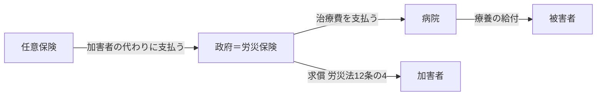

# 交通事故×労災保険｜損害賠償からの控除メモ（認定司法書士実務用）

> 2026-11-15 のやりとりを保存。元の説明には判例・制度と違う箇所があったので、**訂正済みの内容**で残す。
> このフォルダは `.vercelignore` で除外しているので、サイトには公開されない。

---

## 1. 給付項目ごとの控除の早見表

| 労災給付 | 控除するか | どの損害項目から引くか（費目拘束） | 根拠・メモ |
|---|---|---|---|
| 療養（補償）給付 | ✅ する | **治療費だけ** | 政府が加害者に求償する（労災保険法12条の4第1項） |
| 休業（補償）給付（給付基礎日額の60%） | ✅ する | **休業損害だけ** | 慰謝料から引くことはできない |
| 障害（補償）年金・一時金 | ✅ する | **後遺障害逸失利益だけ** | 年金は**支給済みと支給が確定した分だけ**控除する（最大判平5.3.24） |
| 遺族（補償）年金 | ✅ する | **死亡逸失利益だけ** | 同上 |
| 特別支給金（休業特別支給金20%など） | ❌ しない | — | 社会復帰促進等事業として出る給付で、損害を埋める性質がない（最判平8.2.23 コック食品事件） |
| ―（労災に慰謝料の項目はない） | — | 慰謝料は**全額**請求できる | 労災給付を慰謝料から引くことはできない（最判昭62.7.10 費目拘束） |

### 休業損害の数字（よく間違える）

```
給付基礎日額 ≒ 平均賃金（100%）   ← 「平均賃金の60%」ではない
 ├ 休業補償給付      60% → 休業損害から引く
 ├ 休業特別支給金    20% → 引かない（被害者の手元に残る）
 └ 加害者に請求できる差額 = 40%（＋賞与の減額分など）
被害者が受け取る合計 = 60% + 20% + 40% = 120%
```

---

## 2. 過失相殺との順番 ★元の説明は逆だった

**判例は「先に過失相殺、その後に労災給付を引く」順番（控除前相殺説、最判平元.4.11 高田建設事件）。**

| | 正しい順番（判例） | 間違った順番（元の説明） |
|---|---|---|
| 手順 | ①損害額 × (1 − 過失割合) → ②労災給付を引く | ①損害額 − 労災給付 → ②過失割合を掛ける |
| 例：損害1,000万円・被害者の過失30%・労災給付400万円 | 1,000×0.7 − 400 = **300万円** | (1,000−400)×0.7 = 420万円 |

- 費目拘束があるので、計算は**損害項目ごと**に行う。ある項目で労災給付が過失相殺後の金額を上回っても、上回った分をほかの項目（慰謝料など）から引くことはできない。
- そのため、裁判の計算では**治療費も損害総額に入れたうえで**過失相殺し、療養給付を引く。「治療費は計上しない」は、過失がない場合の簡略化にすぎない。
- 労災給付はまず損害の**元本**に充てる。遅延損害金には充てない（最判平22.9.13）。
- ※令和2年の民法改正後も、この順番の扱いは基本的に変わっていない。

---

## 3. 求償の流れ（治療費）



- 求償するのは**政府**（実際の窓口は労働局・労基署）。
- 元の説明にあった「社会保険診療報酬支払基金」は**健康保険の話で、労災とは関係ない**。
- 被害者と保険会社の示談交渉では、労災が払った治療費は基本的に話し合いの対象から外れる（過失がある場合は上の2を参照）。

---

## 4. その他の実務上の注意

| 論点 | ポイント |
|---|---|
| 示談の先行リスク | 示談で損害賠償の残りを**全部放棄（免除）**すると、その範囲で**以後の労災給付が受けられなくなる**（労災法12条の4第2項、最判昭38.6.4）。示談書の「清算条項」は特に注意する |
| 第三者行為災害届 | 交通事故で労災を使うときは、労基署への提出が必要 |
| 自賠責との先後 | 行政の通達では原則「自賠責が先」だが、被害者がどちらを先にするか選べる。過失が大きい・相手が無保険などの場合は労災を先にするほうが有利なことが多い |
| 自賠責と任意保険 | 別の保険。「自賠責保険（任意保険）」のように混ぜて書かない |
| 障害補償年金の将来分 | 支給がまだ確定していない将来分は控除しない（最大判平5.3.24） |
| 認定司法書士の代理権 | 訴額（請求額）**140万円以内**に限られる（司法書士法3条1項6・7号）。損害項目ごとに分けて計算した結果、140万円を超えないかを受任時に確認する |

---

## 5. 依頼人への説明（一言版）

- 「労災を使っても**慰謝料は減りません**」
- 「**特別支給金**は相手への請求から引かれないので、まるごと手元に残ります」
- 「休業は、労災の60%＋特別支給金20%に加えて、残りの**40%を相手に請求**します」
- 「労災が払った治療費は、国が相手方の保険会社に直接請求します」
